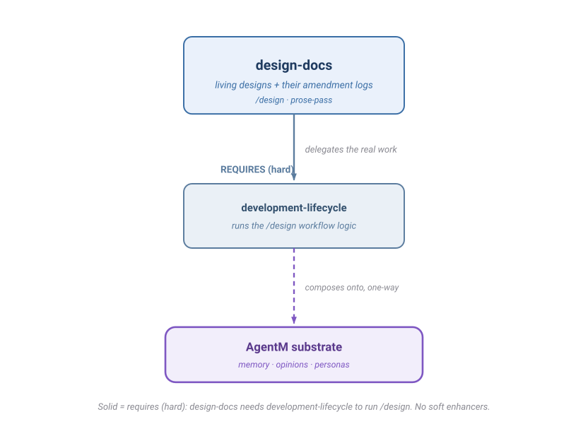

<!-- mode: explanation -->
# Design Docs

## Architecture

Design Docs gives your agent the two disciplines that keep a project's reasoning true: one living design note per area, and a record of each architectural decision so a future reader can trust it. Instead of writing a design once and letting it drift, the agent changes the note whenever a decision settles something, and records why in the same edit — so the hard thinking stays findable, and the next plan starts from it. It also teaches the agent when a decision is worth recording and what a durable record looks like, so the reasoning behind a call survives long after the call is made. It slots on top of the phase loop: Design Docs needs Development Lifecycle installed, and `/plan` reads the notes it keeps.

### Diagram

How the plugin composes:

### How it works

The plugin does two things. The first is the living design note. A project keeps one note per area in its vault, with four parts: the objective, the current design, the open questions, and an amendment log. The `/design` command writes a new note or updates an existing one, and the body and the log entry change in the same edit, so the note never says one thing while its history says another. There is no draft-to-final status and no review stage: the note is live from the first save. `/plan` finds the note that governs its task and holds the plan to the calls in it. The plugin never publishes notes to the repo's `wiki/designs/`; the pages already there stay as they are.

The second is the decision-record discipline. As the agent works, it watches for genuine architectural decisions — the kind whose reasoning a future reader will need — and knows both when one is worth recording and what a durable record should contain: the context, the call and why not the alternative, the consequences, and a trigger for revisiting it later. This runs on its own, whenever such a decision comes up, not only when you ask for it. It is aimed mainly at projects that still keep standalone decision-record files; crickets and agentm themselves now fold decisions into their living designs instead.

### Composition

| Direction | Plugin | How |
|---|---|---|
| Enhances (soft) | — | None. |
| Enhanced by (soft) | — | None. |
| Requires (hard) | [Development Lifecycle](Development-Lifecycle) | `/plan` and the session-start hook, both in development-lifecycle, find the notes `/design` writes, through `vault_designs.py`. |
| Required by (hard) | — | None. |

### Why not

Design Docs is opinionated about how design authoring should flow, and it will not fit every project. Reach for something else if:

- You do not run the harness's plan-driven workflow — the notes exist for `/plan` to read, so without `development-lifecycle` they have no reader.
- Your project still keeps standalone ADR files and wants a heavier decision-record tool; the `adr` skill teaches a format and a discipline, it does not manage an ADR index or lifecycle.
- The change in front of you is small and self-explanatory. A one-file fix rarely needs a design note or a decision record, and updating one for it is more ceremony than the work warrants.

## Reference

### Commands & skills

Each primitive links to the source that implements it.

| Primitive | Kind | What it does |
|---|---|---|
| [`/design`](https://github.com/alexherrero/crickets/blob/main/src/design/commands/design.md) | command | Write or update the living design note for an area: objective, current design, open questions, amendment log. |
| [`adr`](https://github.com/alexherrero/crickets/blob/main/src/design/skills/adr/SKILL.md) | skill | Decision-record discipline — when to write an ADR and the five-section shape with re-audit triggers. |

### Configuration

No configuration — the plugin works out of the box. The `/design` command finds the notes folder through agentm, and the `adr` skill draws its canonical shape from the `adr-shape` entry in `~/.claude/CLAUDE.md`; neither adds a config key of its own.

## See also

- [How to author a design](Author-A-Design) — the steps for writing or updating a design note with `/design`.
- [How to record an architectural decision](Record-An-Architectural-Decision) — the amendment-log workflow, and where the `adr` skill still applies.
- [Development Lifecycle](Development-Lifecycle) — reads the notes this plugin keeps, through `/plan`.
- [Development lifecycle design](crickets-development-lifecycle) · [Design-docs design](crickets-design) — the deeper design.

[Reference](Reference) · [Architecture](Architecture) · [Home](Home)