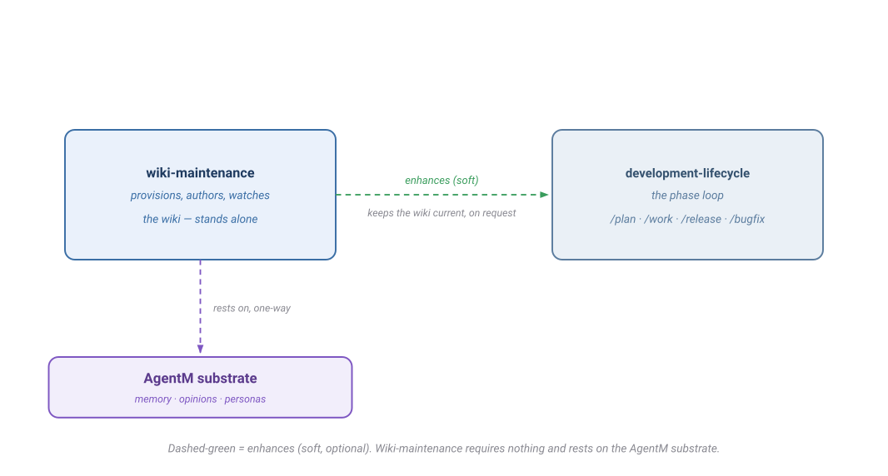

<!-- mode: explanation -->
# Wiki Maintenance

## Architecture

Wiki Maintenance keeps a repo's docs current. It sets up a wiki and updates the docs as the code changes. Every page keeps a six-section shape and your writing voice. Hand-tended wikis drift, so this plugin enforces the structure and drafts from the voice lessons in your vault. It stands alone in any repo and works with Development Lifecycle when installed.

### Diagram

The authoring flow, from a request or code change through page choice to the documenter:

How Wiki Maintenance composes with AgentM and Development Lifecycle:

### How it works

Start by scaffolding the wiki with `/wiki-init`. It lays down the folders, sidebars and landing pages, and never overwrites existing pages. After that, ask in plain English to update the wiki. The plugin picks the page and hands writing to the documenter, a sub-agent that edits only the wiki, keeps your hand edits, and never touches code. Each write chooses the page mode, fills the template, and runs a voice pass. One skill, `wiki-author`, holds the six-section rules, the templates and the voice files. Your voice lessons live in the vault, and you edit them by hand when you want the wiki to sound different. Crickets plan 105 retired the old `diataxis-author` skill, which also repaired, migrated and classified pages and learned lessons from your edits.

For ongoing upkeep, a watcher runs on its own. Each run checks recent code changes and decides what needs docs. It then sends the documenter, which opens a pull request by default so a human still merges it. Scheduled runs never double up or drop changes. Phase commands never call the watcher; docs stay a pass you choose. Use `wiki-author` for targeted updates, `wiki-watch` for scheduled upkeep, and `/wiki-init` to start a wiki.

### Composition

| Direction | Plugin | How |
|---|---|---|
| Enhances (soft) | [Development Lifecycle](Development-Lifecycle) | `wiki-author` and `wiki-watch` keep the wiki current on request or schedule (`enhances: documentation`). No phase command dispatches the `documenter`. |
| Enhanced by (soft) | — | None. |
| Requires (hard) | — | None. Standalone (`requires: []`). |
| Required by (hard) | — | None. |

### Why not

Wiki Maintenance is opinionated and will not fit every project. Skip it if:

- You already run a docs pipeline you like. This plugin owns `wiki/` shape and voice and conflicts with other conventions.
- You want a free-form wiki. Diátaxis single-mode structure is enforced, so unstructured pages read as drift.
- Your docs are small. A one-page README or quick hand edit needs no scaffolding or watcher.

## Reference

### Commands & skills

Each primitive links to the source that implements it.

| Primitive | Kind | What it does |
|---|---|---|
| [`/wiki-init`](https://github.com/alexherrero/crickets/blob/main/src/wiki/commands/wiki-init.md) | command | Scaffold a wiki to the intent-group structure; idempotent, preview-first. |
| [`/wiki-watch`](https://github.com/alexherrero/crickets/blob/main/src/wiki/commands/wiki-watch.md) | command | Run one watcher cycle on a loop or cron. Ships as a skill on Antigravity. |
| [`/recent-wiki-changes`](https://github.com/alexherrero/crickets/blob/main/src/wiki/commands/recent-wiki-changes.md) | command | List recently modified wiki pages across registered repos. |
| [`wiki-author`](https://github.com/alexherrero/crickets/blob/main/src/wiki/skills/wiki-author/SKILL.md) | skill | The one wiki skill: pick the page and mode, dispatch the documenter, and hold the six-section rules, templates, style files, and gate scripts. |
| [`documenter`](https://github.com/alexherrero/crickets/blob/main/src/wiki/agents/documenter.md) | sub-agent | Write-executor: creates, updates, and prunes pages; keeps human edits; never touches code. |

### Configuration

Authoring works out of the box. The watcher stays off until you enable both settings:

- **Device toggle** — set `wiki_watch.enabled: true` (or `wiki_watch_enabled: true`) in `<install-prefix>/.agentm-config.json`.
- **Per-repo marker** — add `<repo>/.harness/wiki-watch.json` to opt in. It carries `watch_sources` and `dispatch_mode` (`pr` default, or `direct` for a trusted repo).

Per-repo voice and structure overrides live in `wiki/.diataxis-conventions.md`. Global structure rules live in `diataxis-*.md` files under `<vault>/standards/`, and global voice lessons live in `<vault>/standards/voice/`. Older vaults fall back to the retired `_always-load/` and `_global/wiki-style/` folders.

## See also

- [Provision a repo's wiki](Provision-A-Repo-Wiki) · [Run the wiki-watcher](Run-The-Wiki-Watcher) — the how-tos.
- [Wiki Watch Config](Wiki-Watch-Config) — the watcher config.
- [Wiki design](crickets-wiki) — why provisioning joins authoring, and the gate-distribution split.
- [Development Lifecycle](Development-Lifecycle) — the base plugin whose wiki this keeps current.
- [Antigravity Limitations](Antigravity-Limitations) — which surfaces are Claude-first.

[Reference](Reference) · [Architecture](Architecture) · [Home](Home)
