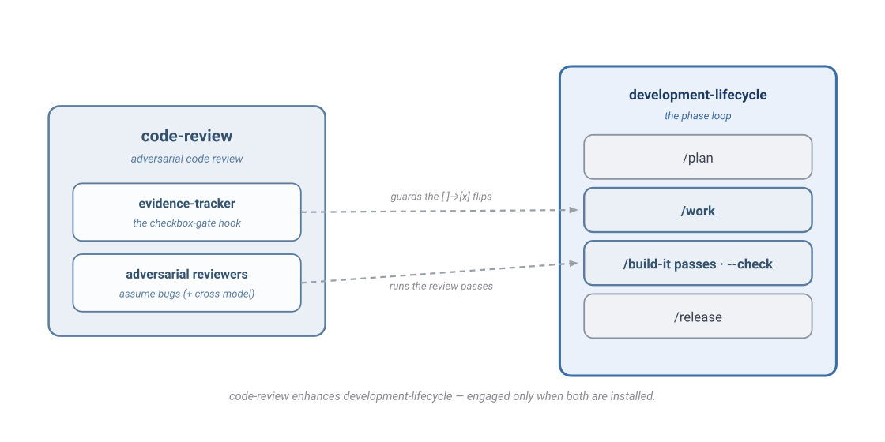

<!-- mode: reference -->
# Code Review

## Architecture

Code Review gives your agent a skeptical second pair of eyes on any change. It does not confirm your code looks fine. It assumes there is a bug. It tries to prove the bug exists. It catches real problems that a rubber-stamp review misses.

### Diagram

### How it works

You point it at a diff or a PR. It runs an adversarial review. A reviewer reads the change. It assumes the change contains a bug. When Gemini is available, a second reviewer does the same from a different model. The two reviewers do not share one model's blind spots. Each reviewer returns an actionable result. It returns a failing test, a `DEFECT: file:line`, or `NO ISSUES FOUND`. It never returns loose prose.

When you install `development-lifecycle`, these reviewers run automatically at the `/review` phase. An `evidence-tracker` hook stops a task from being ticked off. The agent must read the spec and test files first.

### Composition

| Direction | Plugin | How |
|---|---|---|
| Enhances (soft) | [Development Lifecycle](Development-Lifecycle) | Runs the adversarial reviewers at `/review` and guards `/work`'s checkbox flips — only when both are installed. |
| Enhanced by (soft) | — | None. |
| Requires (hard) | — | None. Code Review is fully standalone. |
| Required by (hard) | — | None. |

### Why not

Code Review is opinionated. It does not fit every workflow. Choose something else if:

- You trust another review pass. This pass could be a human reviewer, a linter suite, or a different AI reviewer. You do not want a second opinion on every change.
- You want a reviewer that explains its reasoning. This reviewer deliberately answers only with a failing test, a `DEFECT: file:line`, or `NO ISSUES FOUND`.
- You want the reviewer to assume the code is fine. The assume-a-bug framing is adversarial. It feels like overkill on small or throwaway changes.

## Reference

### Commands & skills

Each primitive links to the source that implements it.

| Primitive | Kind | What it does |
|---|---|---|
| [`/code-review`](https://github.com/alexherrero/crickets/blob/main/src/code-review/commands/code-review.md) | command | Adversarial review of a diff or PR. |
| [`/doubt`](https://github.com/alexherrero/crickets/blob/main/src/code-review/commands/doubt.md) | command | Fresh-context review of a decision before it stands. |
| [`/simplify`](https://github.com/alexherrero/crickets/blob/main/src/code-review/commands/simplify.md) | command | Cut accidental complexity from a change. |
| [`security-review`](https://github.com/alexherrero/crickets/blob/main/src/code-review/skills/security-review/SKILL.md) | skill | Three-tier boundary security review. |
| [`testing-strategy`](https://github.com/alexherrero/crickets/blob/main/src/code-review/skills/testing-strategy/SKILL.md) | skill | Coverage audit — the Beyoncé Rule, DAMP, Prove-It. |
| [`adversarial-reviewer`](https://github.com/alexherrero/crickets/blob/main/src/code-review/agents/adversarial-reviewer.md) | sub-agent | Assume-bugs critic; returns a failing test or a `DEFECT`. |
| [`adversarial-reviewer-cross`](https://github.com/alexherrero/crickets/blob/main/src/code-review/agents/adversarial-reviewer-cross.md) | sub-agent | The same, cross-model via Gemini; degrades visibly — a `CROSS-REVIEW-DEGRADED: <reason>` line, never a silent same-model swap, whenever `cross-review.sh` cannot return a review (an unknown `--tier` or argument exits 2 first, with no marker): `agy` missing or failing, its print timeout running out, material over the size ceiling, or a reply that breaks the output contract twice. |
| [`security-auditor`](https://github.com/alexherrero/crickets/blob/main/src/code-review/agents/security-auditor.md) | sub-agent | Finds the unvalidated boundary crossing. |
| [`test-engineer`](https://github.com/alexherrero/crickets/blob/main/src/code-review/agents/test-engineer.md) | sub-agent | Finds the behavior with no test. |
| [`evidence-tracker`](https://github.com/alexherrero/crickets/blob/main/src/code-review/hooks/evidence-tracker/hook.md) | hook | Blocks a `[ ] → [x]` flip until specs and tests are read (Claude-only). |
| [`review_material.py`](https://github.com/alexherrero/crickets/blob/main/src/code-review/scripts/review_material.py) | script | Builds the text a reviewer sees: `ARTIFACT`, `CONTRACT`, `RULES`. Pipe it into `cross-review.sh`. |

### Configuration

You do not need to configure anything. The plugin works out of the box. The cross-model reviewer's model, timeout and size ceiling are tunable, as below.

#### Cross-review tiers

`cross-review.sh` picks its Gemini model by tier. Select one with `--tier <name>` or the `CROSS_REVIEW_TIER` environment variable; the flag wins. With neither, the tier is `default`.

| Tier | Model | Print timeout | Material ceiling | Use for |
|---|---|---|---|---|
| `default` | Gemini 4 Neon (Medium) | 180 s | 50 KB | Ordinary review passes. |
| `high` | Gemini 4 Neon (High) | 300 s | 80 KB | Direction checks; correctness on large tasks. |
| `wording` | Gemini 4 Hydrogen (High) | 180 s | 50 KB | Wording and voice only. |

An unknown tier, or any unknown argument, exits 2 before `agy` is called and prints no `CROSS-REVIEW-DEGRADED` line.

#### Cross-review overrides

Each override applies on top of the chosen tier.

| Variable | Effect |
|---|---|
| `CROSS_REVIEW_MODEL` | Exact `agy models` display string; beats any tier's model. |
| `CROSS_REVIEW_TIMEOUT_SECS` | Positive integer seconds; replaces the tier's print timeout. A malformed value is ignored with a note on stderr. |
| `CROSS_REVIEW_MAX_BYTES` | Byte count; replaces the tier's material ceiling. `0` turns the check off. A malformed value is ignored with a note on stderr. |

#### Review material

`review_material.py` prints three blocks: `=== ARTIFACT ===` (the change), `=== CONTRACT ===` (what it was meant to do), and `=== RULES ===` (the rules it must follow, one per line). It reads no reasoning and takes no suspected bug. Standard library only; needs `git`, plus `gh` for `--pr`.

| Option | Effect |
|---|---|
| `--range A..B` · `--worktree` · `--pr N` · `--files PATH...` | The artifact: a git range, the working tree against `HEAD`, untracked files included as new files, a PR diff, or files as they are. |
| `--contract TEXT` · `--contract-file F` | The contract text. |
| `--anchor FILE` | The spec, plan or design the change is held to. Without one, `RULES` is empty and says why; exit 0. |
| `--repo-root DIR` | The repo whose `AGENTS.md` and `CLAUDE.md` are searched. Default: the current directory. |
| `--tier default\|high\|wording` | Picks the byte ceiling: 50 KB, 80 KB, 50 KB. |
| `--max-rule-lines N` · `--max-bytes N` | Cap the rule lines (default 40); override the ceiling (`0` = none). |

`RULES` draws first from the anchor: a spec's Rules with their sources, else a plan or design's Locked design calls and Constraints, plus any Likeness list. It then adds the `AGENTS.md` and `CLAUDE.md` paragraphs that share the most terms with the changed paths and identifiers, rarer terms counting more. The same inputs give the same output. Exit 2 on a usage error, an unreadable input, or an empty artifact ("nothing to review").

## See also

- [First code review](01-First-Code-Review) — the tutorial.
- [Review a change](Use-Code-Review) · [Simplify a diff](Simplify-A-Diff) · [In-flight decision review](Use-Doubt-Review) — the how-tos.
- [Why adversarial review](Why-Adversarial-Review) — why the assume-bugs framing works.
- [Code-review design](crickets-code-review) · [Composition design](crickets-composition) — the deeper design.

[Reference](Reference) · [Architecture](Architecture) · [Home](Home)
