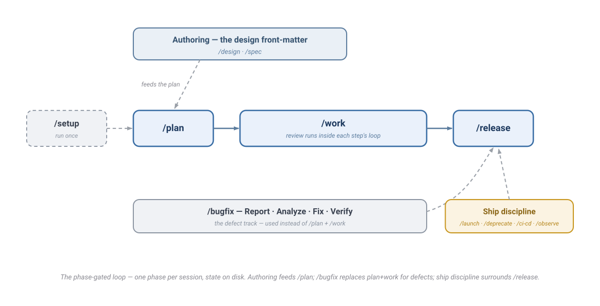

<!-- mode: reference -->
# Development Lifecycle

## Architecture

Development Lifecycle is a set of opinionated workflows. It covers every phase of development. These phases range from ideation and design to implementation and release. The agent saves its state to disk through AgentM's memory as it works. This lets you split a change across several agents. You can give different sessions different kinds of work. You might do research and design in one session. You can do implementation or cleanup in another. The agent always knows where it left off. Other crickets plugins enhance many of its steps when they are installed.

### Diagram

This diagram shows the workflow. It outlines the phase-gated loop. It includes the authoring feed. It displays the `/bugfix` track.

This diagram shows how the lifecycle composes. It details what enhances the loop. It lists what requires the loop. It illustrates the AgentM substrate it rests on.

### How it works

Development Lifecycle moves a change from a rough **idea** to a shipped feature. It progresses one gated step at a time. Its commands map directly onto that flow.

You start with an **idea**. This can be a brief, a feature request, or a bug. **Research** then fills in what the agent hasn't seen: the `explorer` agent does a read-only sweep of the codebase. You move to **architecture and design** once the shape becomes clearer. The `/spec` command writes the anchor a task is graded against. It asks at most five questions, and only when the brief is ambiguous. The `/design` command keeps the project's living design note true. `/plan` reads that note for the calls a plan must honour. The plans come from `/plan`. The `/plan` command turns a brief into a plan of steps with pass/fail criteria, and opens the plan's tracker. Each step names the spec it is graded against, and whether it is build or create work and how big it is. A larger piece of work can be several named plans. You then start the **work**. The `/work` command runs a plan's steps one at a time, keeping its tracker current. It runs each step's loop (`/build-it` or `/create-it`) itself. It stops only when a safety check fails or it needs a decision. For bigger efforts, `/work` spawns its own isolated worktree for the plan. It uses the host's native worktree primitive for this. It closes the worktree out with an auto-merging pull request. This happens when you configure `isolation.mode: worktree-per-plan`. It also happens when you ask for one explicitly. You do not need to run a separate spawn or integrate command. Every step is **reviewed** inside its own loop: a direction check, review passes and a done-check. To review a change someone already made, run `/build-it --check`; it reports and never fixes. Every change is shipped through the `/release` gate. The `/bugfix` command provides a shorter track for defects. This track follows a Report → Analyze → Fix → Verify flow.

The whole loop runs on disk instead of in the conversation. The plan lives in files. Its progress lives in files. Its tracker, written by agentm, says where the plan stands. The project's state lives in files. This on-disk storage lets one plan span many sessions.

### Composition

| Direction | Plugin | How |
|---|---|---|
| Enhances (soft) | — | None. Development Lifecycle is the base, not an enhancer. |
| Enhanced by (soft) | [Code Review](Code-Review) · [Developer Safety](Developer-Safety) · [Wiki Maintenance](Wiki-Maintenance) | Code Review's reviewers and `cross-review.sh` run `/build-it`'s review passes; Developer Safety adds its recoverability control across the loop; Wiki Maintenance keeps the wiki current on request (`wiki-author`) or on a schedule (`wiki-watch`), and no phase command dispatches it — each only when installed alongside. |
| Requires (hard) | — | None. Development Lifecycle is fully standalone (`requires: []`). |
| Required by (hard) | [Design Docs](Design-Docs) · [GitHub CI](GitHub-CI) · [GitHub Projects](GitHub-Projects) · [Releasing Conventions](Releasing-Conventions) | Each declares `requires: [development-lifecycle]` — they extend the phase loop and do not install without it. |

### Why not

Development Lifecycle is opinionated about how a change should move from brief to merge. You should reach for something else if any of these apply:

- You already run a lifecycle you like. This could be your own scripts. It could be a CI-driven flow. It could be a different agent harness. You do not want a second set of phase commands layered on top.
- You prefer a freeform, single-pass style. The discrete `plan → work → release` gates are deliberate. They can feel heavier than the change warrants on a small or throwaway change.
- You want the loop without agentm, or without its on-disk state contract. The plugin keeps each plan, its progress log and its tracker where agentm puts them, and treats them as the source of truth between sessions. With no agentm there is no plan, and the phases have nothing to run on.

## Reference

### Commands & skills

Each primitive links to the source that implements it. The commands are host-symmetric. The three agents are host-symmetric. The two hooks are Claude-only ([Antigravity limitations](Antigravity-Limitations)).

| Primitive | Kind | What it does |
|---|---|---|
| [`/setup`](https://github.com/alexherrero/crickets/blob/main/src/development-lifecycle/commands/setup.md) | command | First-time project scaffold — writes the repo's `.harness/` tools, and seeds a plan only where agentm gives a path back. Run once. |
| [`/plan`](https://github.com/alexherrero/crickets/blob/main/src/development-lifecycle/commands/plan.md) | command | Turn a brief into `PLAN.md` with per-step verification criteria, and open its tracker. No code. Its interview step is a `/spec` step: it runs `/spec` for the task (`--plan <plan>`; `--multi` when one spec covers several tasks) and takes the plan's success criterion from the spec's Done when and its out-of-scope from Not doing. Each step carries `**Anchor:**` (the spec's path), `**Profile:**` (`build`, `create` or `both`) and `**Size:**` (`small`, `medium` or `large`) after `**What**`; a step with none of them is a legacy step: build, medium, anchored to the plan. |
| [`/work`](https://github.com/alexherrero/crickets/blob/main/src/development-lifecycle/commands/work.md) | command | Work the plan's steps autonomously, single-threaded, safety-gated per step, keeping its tracker current. Reads each step's Anchor, Profile and Size and runs its loop by following `/build-it --spec <Anchor> --size <Size>` or `/create-it` (it points at them; it does not copy them). The direction check runs before any code, inside the safety pre-check, for medium and large steps, and a real finding is a stop trigger. The loop's free checks are the step's gates, run once; the review passes follow once green. The step's done-report (`loop_record.py report`) is pasted into `progress.md` under its completion line. |
| [`/release`](https://github.com/alexherrero/crickets/blob/main/src/development-lifecycle/commands/release.md) | command | Pre-merge gate — the plan's status is done, gates green, run to completion under the recoverability gate. Its recoverability gate is an 80-word summary: recoverable actions are announced and proceed, unrecoverable ones stop and confirm, and the full doctrine is `developer-safety`'s `recoverability` skill. It does not wait on docs or post to a project board; when the release closes an arc, it runs the coalescence checklist before tagging. |
| [`/bugfix`](https://github.com/alexherrero/crickets/blob/main/src/development-lifecycle/commands/bugfix.md) | command | Defect pipeline — Report → Analyze → Fix → Verify. Used instead of plan-plus-work. Verify runs `/build-it --check` on the fix. |
| [`/spec`](https://github.com/alexherrero/crickets/blob/main/src/development-lifecycle/commands/spec.md) | command | Write the anchor a task is graded against, one file per task: Goal, Done when, Rules (each with its source), Not doing, Open questions; a create-profile spec adds a Reference folder and a 5–10 line Likeness list. Asks at most 5 batched questions, only when the brief is ambiguous; one operator approval. `/plan` sends a task with no spec here, with `--plan <plan>`. Helper: `scripts/spec_doc.py` (`place`, `check`, `render`). |
| [`/build-it`](https://github.com/alexherrero/crickets/blob/main/src/development-lifecycle/commands/build-it.md) | command | The whole loop for code: anchor (the spec, else `/spec`; with no human, the plan step and its Locked design calls), size (small, medium or large; `--size` overrides), a direction check on the `high` review tier that stops and asks you when the approach is wrong, make, the repo's own checks before any reviewer, then correctness and simplicity passes (security when the task touches auth, secrets, shell execution or network input). Findings are sorted real, tradeoff, misread or noise, each with a cited line; a pass gets 3 rounds before you decide. A degraded cross-model review is announced and replaced by a Sonnet reviewer. Ends with the done-report and the `evaluator`'s done-check. `--check <PR number \| A..B \| diff file>` runs the passes and report on an existing change and never fixes. `/work` runs it for each build step; you can also run it by hand. Needs no agentm. |
| [`/create-it`](https://github.com/alexherrero/crickets/blob/main/src/development-lifecycle/commands/create-it.md) | command | The whole loop for art, sound, UI look and prose, `/build-it`'s sibling. Anchor: a spec with a `reference/` folder and a 5–10 line likeness list (with no human, no reference and no list: stop). Size, then a direction check on the `high` review tier that stops and asks you when the direction is wrong. Make, then `asset_checks.py` on every PNG and WAV (a difference is looked at, not an automatic fail; skipped items land in Not checked). Passes run one at a time: likeness (the `evaluator` reads the paired images, one rubric item per likeness line), craft (the `default` review tier, over measurements and text only; it sees no pixels or sound), and for prose a voice pass (`prose_pass.py` on the `wording` tier, Gemini 4 Hydrogen (High); a longer revision is refused). The done-report carries the paired images and a playtest checklist; general playtest feedback is offered back as a new likeness line, never added unasked. A degraded cross-model or prose pass is announced and redone on a Sonnet reviewer. `/work` runs it for each create step; you can also run it by hand. Needs no agentm. |
| [`loop_record.py`](https://github.com/alexherrero/crickets/blob/main/src/development-lifecycle/scripts/loop_record.py) | script | The bookkeeping helper the build-it / create-it loop commands call; `/build-it` and `/create-it` call it. `passes --profile build\|create\|both --size small\|medium\|large [--security] [--prose] [--no-voice]` prints the reviews to run, in order, as JSON: small none; medium direction, the profile's first pass and a done-check; large every pass. Each entry carries its cross-review tier (direction `high`; correctness `default` at medium, `high` at large; voice `wording`; the rest `default`). `init`, `open-round`, `add`, `stop` and `status` keep a JSON record at a path you supply. `add` takes a class (`real`, `tradeoff`, `misread`, `noise`) and a cited `path:LINE`, and refuses a finding without one. `stop` says done when the latest round has no `real` finding, and escalates (exit 3) when round 3 still has one; a fourth round is refused. `status` flags doubt theater: two or more rounds with findings and no `real` one. `add-security` adds the security pass after correctness when the finished diff turns out to need it; `dispose` records what was done with a finding (`add` also takes `--disposition`); `requirement` records a Done-when line as `met` or `not-met`, and refuses either without evidence; `not-checked` lists what the run did not look at; `pair` and `playtest` (create-it) record a reference beside what was made, and a playtest checklist line. `report` prints the done-report as markdown (`/work` pastes it into `progress.md` under the step's completion line for medium and large steps): Requirements with evidence; Reviews with every finding, its cited line and its disposition (a `real` finding nobody dealt with reads `OPEN`); a Not checked section that is always present, and lists every review the size called for that never ran; for create-it, Paired images and a Playtest checklist. The done-check is not listed as unrun, since it grades this report. Standard library only. |
| [`asset_checks.py`](https://github.com/alexherrero/crickets/blob/main/src/development-lifecycle/scripts/asset_checks.py) | script | The free checks for the create-it loop; `/create-it` calls it. `check MADE [--reference REF] [--grid COLSxROWS \| --frame-size WxH] [--out-dir DIR] [--length-tolerance 0.05] [--level-tolerance-db 3] [--json]` measures a PNG (size, frame count from an APNG or a sprite-sheet grid, empty frames, colour palette) or a WAV (length, sample rate, channels, peak and RMS dBFS). With `--reference` it lists each difference: PNG size, frame count, new and missing colours; WAV rate, channels, and length or level beyond the tolerance. With `--out-dir` and ImageMagick or ffmpeg installed it also writes a side-by-side PNG and a WAV spectrogram (ffmpeg); whatever it cannot do is listed under `skipped`, never dropped. Exit 0 clean, 1 a difference, 2 an unreadable file. Standard library only. |
| [`vault_designs.py`](https://github.com/alexherrero/crickets/blob/main/src/development-lifecycle/scripts/vault_designs.py) | script | Finds the living design notes in the project's vault; `/plan` step 1b and the session-start hook call it. `list [--limit N]` prints the live notes, newest first. `find TARGET` prints the one note that governs a path or area name: a `governs:` entry scores 10, an alias or slug equal to the area name 5, each matching tag 1; it needs 2 to count, and a tie goes to the newer `updated:`. Exit 0 answered, 1 nothing governs the target, 2 usage, 3 no designs folder. Reads frontmatter only; standard library only. |
| [`/design`](https://github.com/alexherrero/crickets/blob/main/src/design/commands/design.md) | command | Write or update the one living design note for an area in the project's vault: Objective, Current design, Open questions, Amendment log. The body and the log change in the same edit. No status gate, nothing published to `wiki/designs/`. From the `design` plugin. |
| [`/open`](https://github.com/alexherrero/crickets/blob/main/src/development-lifecycle/commands/open.md) | command | LOCATE a project by name (registered repos, vault `projects/` tree, agentm recall), CONFIRM the match, then ORIENT: agentm's opening brief, the project's plans with their tracker status, recent progress, queued plans and board state. Read-only; the one project entry point (`/orient` and `/queue-status-lite` retired in crickets plan 105). See [Open a project by name](Open-A-Project-By-Name). |
| [`worker`](https://github.com/alexherrero/crickets/blob/main/src/development-lifecycle/agents/worker.md) | sub-agent | The autonomous executor of a named plan, one per worktree; pins the `sonnet` model alias. The one coordinator role left. |
| [`evaluator`](https://github.com/alexherrero/crickets/blob/main/src/development-lifecycle/agents/evaluator.md) | sub-agent | Read-only rubric grader (`Read`, `Glob`, `Grep`), pinned to the `sonnet` model alias. Also runs the build-it / create-it done-check: grades the anchor and the `loop_record.py report` against fixed checks. `/build-it` and `/create-it` dispatch it for the done-check; `/create-it` also uses it for the likeness pass. See [Evaluator](Evaluator). |
| [`explorer`](https://github.com/alexherrero/crickets/blob/main/src/development-lifecycle/agents/explorer.md) | sub-agent | Read-only codebase fan-out for gathering context. |
| [`harness-context-session-start`](https://github.com/alexherrero/crickets/blob/main/src/development-lifecycle/hooks/harness-context-session-start/hook.md) | hook | Injects harness context at session start (Claude-only). |
| [`compact-nudge-resume`](https://github.com/alexherrero/crickets/blob/main/src/development-lifecycle/hooks/compact-nudge-resume/hook.md) | hook | Nudges a resumed session to pick the loop back up from disk state (Claude-only). |

### Configuration

There is no plugin configuration. The phase commands read and write the project's on-disk state: the plan, progress and tracker files, plus optional project settings. That is project state the loop maintains, not settings you configure up front. agentm decides where it lives, and the plugin asks. In a project bound to your vault, each plan is a numbered task (`tasks/NNN-<slug>/`), and the plan's tracker records what is done. A repo with no vault keeps its plans repo-local under `.harness/`. The repo's own tools (`init.sh`, `verify.sh`, `project.json`) stay in `.harness/` either way.

## See also

- [Named plans](Named-Plans) · [Open a project by name](Open-A-Project-By-Name) — These documents cover the multi-plan surface.
- [Run a named plan](Run-A-Named-Plan) · [Run isolated tasks](Run-Isolated-Tasks) — These documents detail the worktree lifecycle. They include `/work`'s own auto-spawn and auto-close-out.
- [Evaluator](Evaluator) — This document explains the grader's dispatch contract and the done-check.
- [Code Review](Code-Review) · [Developer Safety](Developer-Safety) — These are the sibling plugins that enhance the loop.
- [Why phase-gating](Why-Phase-Gating) · [Why adversarial review](Why-Adversarial-Review) — These documents explain why the loop is shaped this way.
- [Development lifecycle design](crickets-development-lifecycle) · [Composition design](crickets-composition) — These documents detail the deeper design.

[Reference](Reference) · [Architecture](Architecture) · [Home](Home)